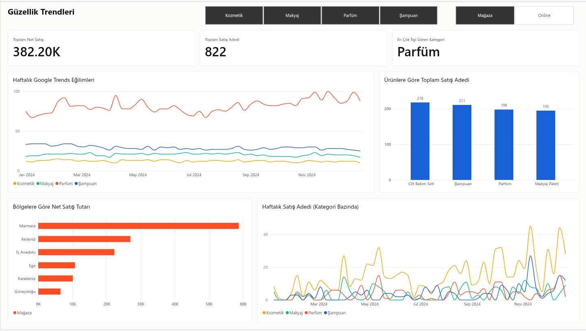

# Güzellik Trendleri (beauty_trends)

Google Trends arama ilgisi ile bir perakende zincirinin kozmetik satışlarını birlikte inceleyen, dbt ve Power BI tabanlı bir dönem projesi.

## [Power BI dashboard](https://app.powerbi.com/links/9qZuT8BHzT?ctid=de24a125-09c4-4916-a8eb-d3d035168252&pbi_source=linkShare)




## Veri kaynakları

| Kaynak | Dosya | Kapsam |
|---|---|---|
| NovaPerakende satış verisi | `data/perakende_satis.csv` | 2000 sipariş satırı, 2024-01-01 → 2024-12-31 |
| Google Trends (Türkiye) | `data/time_series_TR_20240101-0300_20261104-2056.csv` | Haftalık, 2023-12-31 → 2024-12-29, 4 arama terimi: şampuan, parfüm, makyaj, kozmetik |

Google Trends puanları göreli arama ilgisidir (0–100); mutlak arama sayısı değildir. Analizler yalnızca **Kozmetik** kategorisini ve **2024** yılını kapsar.

## Klasör yapısı

```
Grup14/
├── README.md
├── data/                       Ham veri dosyaları
├── docs/                       Analiz dokümanları
│   ├── kozmetik_satis_analizi.md
│   ├── bolge_kanal_analizi.md
│   ├── google_trends_analiz.md
│   └── trends_satis_karsilastirma.md
├── Guzellik Trendleri Dashboard.pbix
└── beauty_trends/              dbt projesi
    ├── dbt_project.yml
    ├── seeds/                  dbt seed dosyaları (CSV)
    ├── models/
    │   ├── staging/            Temizlenmiş ham veri (view)
    │   └── marts/              Analize hazır tablolar
    └── tests/                  Özel dbt testleri
```

## dbt modelleri

| Model | Katman | Açıklama |
|---|---|---|
| `stg_perakende_satis` | staging | Satış verisini temizler ve tiplendirir |
| `stg_google_trends` | staging | Google Trends verisini temizler ve tiplendirir |
| `mart_kozmetik_satis` | mart | Ürün bazında satış adedi, sipariş, brüt ve net tutar |
| `mart_kozmetik_kanal_bolge` | mart | Kanal (online/mağaza) ve bölge bazında satış |
| `mart_google_trends_ozet` | mart | Trends kategorilerinin ortalama puanları |
| `mart_trends_haftalik` | mart | Haftalık Trends puanları, uzun format (tarih, kategori, puan) |
| `mart_trends_kategori_siralama` | mart | Kategori bazında ortalama, en yüksek/düşük puan ve ilgi sırası |
| `mart_trends_satis_haftalik` | mart | Haftalık Trends puanı ile satışı aynı hafta tanımıyla birleştirir |
| `mart_trends_satis_korelasyon` | mart | Kategori bazında Trends ve satış korelasyonu |

Net satış tutarı: `miktar × birim_fiyat × (1 − indirim_orani)`. `indirim_orani` 0–1 arası bir orandır (0,2 = %20).

## dbt testleri

| Test | Ne kontrol eder |
|---|---|
| `test_trends_puan_araligi` | Arama puanları 0–100 aralığında |
| `test_kozmetik_satis_tutarlilik` | Satış adedi pozitif, net tutar brüt tutarı aşmıyor |
| `test_kozmetik_indirim_orani_araligi` | İndirim oranı 0–1 aralığında |
| `test_kanal_bolge_gecerli_degerler` | Kanal yalnızca Online/Mağaza, bölge boş değil |
| `test_kanal_bolge_tutarlilik` | Değerler pozitif ve mart toplamı staging ile uyumlu |
| `test_trends_satis_ortak_aralik` | Karşılaştırma ortak tarih aralığında ve her kategori eşit haftada |
| `test_trends_satis_korelasyon_araligi` | Korelasyonlar boş değil ve −1 ile 1 arasında |

## Analiz özeti

Ayrıntılar `docs/` klasöründeki dokümanlardadır.

| Konu | Başlıca bulgu | Doküman |
|---|---|---|
| Ürün satışı | Cilt Bakım Seti en çok satan ürün (218 adet); ürünler birbirine yakın. Toplam net satış 382.197,50 | `kozmetik_satis_analizi.md` |
| Bölge ve kanal | Marmara net tutarın yaklaşık %41'ini oluşturuyor; online kanal yaklaşık %65 | `bolge_kanal_analizi.md` |
| Google Trends | En çok ilgi gören kategori parfüm (ortalama 81,7); şampuan yıl boyunca hafif düşüyor | `google_trends_analiz.md` |
| Trends ve satış | Korelasyonlar zayıf (|r| < 0,26) ve anlamlı değil; arama ilgisinin satışı açıkladığına dair kanıt yok | `trends_satis_karsilastirma.md` |

